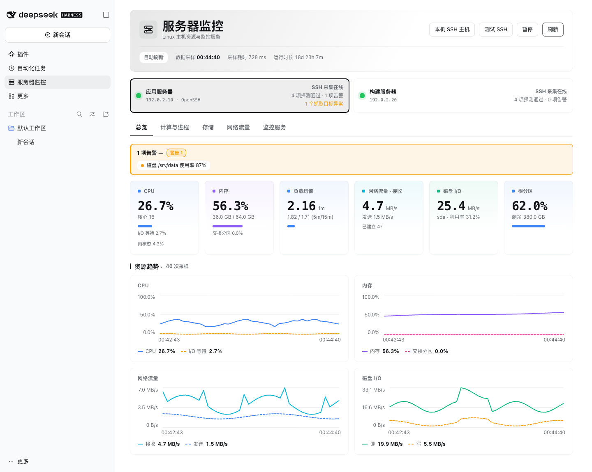

# DSH Server Monitor

**Monitor Linux servers from the DeepSeek Harness sidebar.** Select targets from your local OpenSSH config and see resource history, alerts, and the monitoring services already running on each server.

[简体中文](README.md) · [Download](https://github.com/xiaowill/dsh-server-monitor/releases/tag/v1.3.0-beta.1) · [Setup and configuration (Chinese)](docs/installation.md)



## Install and connect

Verified on the local Web profile in DSH `0.2.2-rc.5`, with OpenSSH and Linux targets.

```sh
dsh plugin --profile web add https://github.com/xiaowill/dsh-server-monitor/releases/download/v1.3.0-beta.1/dsh-server-monitor-1.3.0-beta.1.tgz
dsh --profile web
```

Open **Server Monitor** in the sidebar. Select aliases from your local OpenSSH configuration and merge the generated targets into the active profile’s `cordis.patch.yml`. Replace `[]` if the file contains only an empty list. Verify the host fingerprint in your terminal, then use **Refresh** and **Test SSH**.

```yaml
- id: server-monitor
  config:
    targets:
      - id: app
        sshHost: my-linux-server
```

## What it monitors

- CPU, memory, swap, load, resource pressure, disk latency and network drops
- Process rankings with PID and process name, plus GPU and containers when available
- Grafana version and database health, Prometheus version and scrape targets, and node_exporter reachability
- Uptime Kuma public status-page monitors, their availability and recent response times

Server Monitor probes known loopback ports on selected Linux hosts. You can override service URLs for custom ports or proxy prefixes. The SSH collector is read-only, and its API is served on loopback.

[Architecture (Chinese)](docs/architecture.md) · [Report an issue](https://github.com/xiaowill/dsh-server-monitor/issues) · [MIT License](LICENSE)
