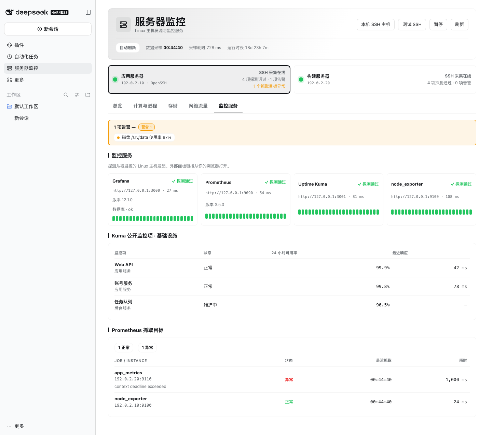
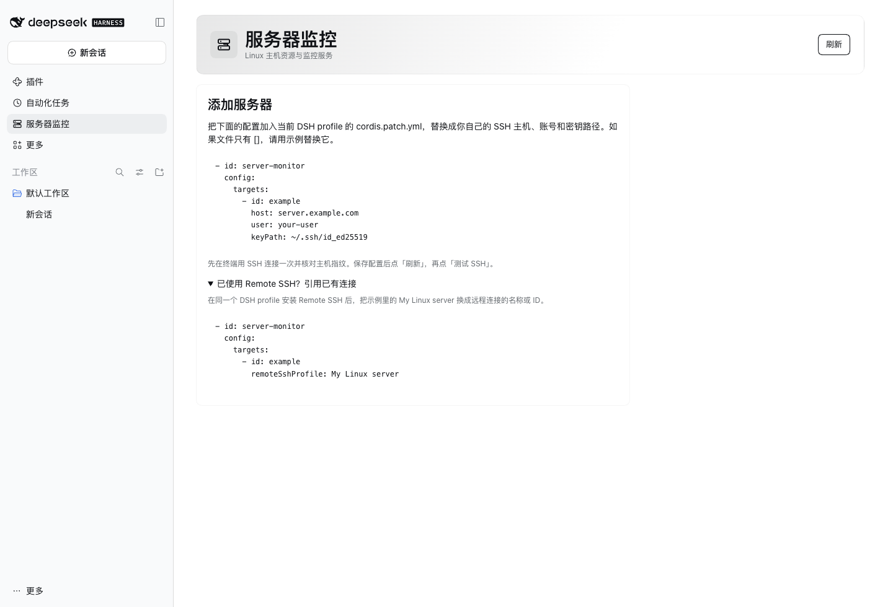

# DSH Server Pulse

[](https://github.com/xiaowill/dsh-server-pulse/actions/workflows/ci.yml)
[](https://github.com/xiaowill/dsh-server-pulse/releases)
[](LICENSE)
[](https://nodejs.org/)

中文 · [English](README.en.md)

**只读监控，不惊扰服务器。** DSH Server Pulse 直接在 DeepSeek Harness 侧栏展示 Linux 服务器指标：无需在远端安装 agent，无需部署 node_exporter，只复用你本机已有的 OpenSSH profile 与密钥。

[安装与配置](docs/installation.md) · [项目架构](docs/architecture.md) · [更新日志](CHANGELOG.md)


*截图使用示例数据。更多画面见下方[界面截图](#界面截图)。*

## 功能特性

- **CPU**：总使用率、iowait、system 占比、上下文切换与中断速率。
- **内存与 Swap**：已用/可用内存、使用率、交换分区使用率。
- **负载**：1/5/15 分钟负载，按 CPU 核心数换算告警阈值。
- **网络与 TCP**：每网卡收发速率、错误与丢包；TCP 状态分布、每秒重传与重传率。
- **磁盘**：挂载点容量与 inode 使用率；物理磁盘 IOPS、吞吐、延迟与利用率。
- **GPU**：通过 `nvidia-smi` 读取利用率与显存（目标机可用时显示）。
- **进程**：CPU/内存占用排行、进程状态分布与僵尸进程计数。
- **容器与系统**：Docker 容器资源占用、失败的 systemd 单元。
- **监控服务探测**：Grafana、Prometheus、Uptime Kuma、node_exporter 的可达性与服务自身数据。
- **阈值告警**：按严重度排序的活动告警，覆盖 CPU、iowait、内存、Swap、磁盘、inode、负载、重传、僵尸进程与 GPU。

所有采集命令均为只读；每台主机在内存中保留最近 60 次采样，断连时保留最后一次成功数据并标明时间。

## 安装

### 方式一：GitHub 直装（`github:`）

在 DSH 所在机器执行，从仓库源码直接安装到指定 profile：

```sh
dsh plugin --profile web add github:xiaowill/dsh-server-pulse
dsh --profile web
```

也可以直接使用仓库 URL：`dsh plugin --profile web add https://github.com/xiaowill/dsh-server-pulse`。源码安装若触发构建脚本，请按 DSH 提示确认。

### 方式二：下载 GitHub Release 的 `.tgz` 后用 DSH 安装

从 [v1.3.0 Release](https://github.com/xiaowill/dsh-server-pulse/releases/tag/v1.3.0) 下载 `dsh-server-pulse-1.3.0.tgz`，然后在下载目录执行：

```sh
dsh plugin --profile web add ./dsh-server-pulse-1.3.0.tgz
dsh --profile web
```

预构建包无需构建脚本，适合离线或受限环境。

### 方式三：DSH 插件市场界面

打开 DSH Web 界面 → **Plugins → Add plugin**，填入 `github:xiaowill/dsh-server-pulse`（或本地目录 / 包名）并安装。若要在 **Discover** 中发现本插件，需开启实验性的 *Custom plugin indexes* 并添加仓库来源。安装后刷新 DSH，从左侧栏打开「服务器监控」面板。

> 三种方式的详细参数、独立试装 profile 与卸载步骤见[安装与配置](docs/installation.md)。

## 自定义配置

面板可读取本机 `~/.ssh/config`（含 `Include`）里的 `Host` 别名。勾选目标后，把生成的条目合并进当前 profile 的 `cordis.patch.yml`；空文件里的 `[]` 直接替换即可。

下面同时展示两种目标形式：SSH 别名（alias）与手动填写 host / user / key。

```yaml
- id: server-pulse
  config:
    targets:
      # 方式一：复用本机 OpenSSH 别名（alias），密钥、端口、ProxyJump 由 OpenSSH 解析
      - id: app
        label: 应用服务器
        sshHost: my-linux-server

      # 方式二：手动填写连接参数（host / user / key）
      - id: db
        label: 数据库服务器
        host: 10.0.0.12
        user: ops
        port: 22
        keyPath: ~/.ssh/id_ed25519
    intervalMs: 3000
    connectTimeoutMs: 8000
```

只采集写入 `targets` 的主机。浏览别名时插件只读本机配置中的名字，不发起 SSH，也不读取密钥内容。`sshHost` 与手填 `host` / `user` / `keyPath` 二选一，不可混填。

## 界面截图

<details>
<summary>展开查看全部截图</summary>

**总览**


**监控服务**



**首次运行：选择 SSH 主机**



</details>

## 告警阈值

| 指标 | 警告（Warning） | 严重（Critical） |
| --- | --- | --- |
| CPU 使用率 | ≥ 85% | ≥ 95% |
| 磁盘 I/O 等待（iowait） | ≥ 20% | ≥ 50% |
| 内存使用率 | ≥ 85% | ≥ 95% |
| Swap 使用率 | ≥ 80% | ≥ 95% |
| 磁盘使用率 | ≥ 80% | ≥ 90% |
| inode 使用率 | ≥ 85% | ≥ 95% |
| 负载（1 分钟 / CPU 核心数） | ≥ 1× | ≥ 2× |
| TCP 重传率 | ≥ 5% | — |
| 僵尸进程数 | ≥ 20 | — |
| 失败的 systemd 单元 | ≥ 1 | — |
| GPU 利用率 | ≥ 85% | ≥ 95% |

## 常见问题（FAQ）

| 现象 | 检查项 |
| --- | --- |
| 看不到 SSH 别名 | 确认 DSH 运行在本机且保存了 OpenSSH 配置，检查 `Host` 与 `Include` 条目 |
| 保存后没有目标 | 确认当前 profile 与 `cordis.patch.yml` 的 YAML 列表格式，然后点「刷新」 |
| 指纹校验失败 | 在终端核对管理员提供的指纹、`known_hosts` 与跳板机配置 |
| SSH 连接超时 | 检查 `connectTimeoutMs`、网络可达性与 ProxyJump；用「测试 SSH」定位原因 |
| 权限被拒绝 | 核对 `user`、`keyPath` 与远端 `authorized_keys`；别名模式下由 OpenSSH 决定身份 |
| 监控服务未识别 | 服务需在目标机本机端口监听；确认反代路径与匿名读取权限，必要时填 `services` |
| Kuma 可达但无监控项 | 确认已发布公开状态页并填写正确的 `statusPage` slug |
| 更改别名指向后历史异常 | 重启 DSH；采样历史随 Host 进程保存在内存中 |

## 开发

```sh
npm run check
npm test
mkdir -p dist
npm pack --pack-destination dist
```

[项目架构](docs/architecture.md) · [安装与配置](docs/installation.md) · [反馈问题](https://github.com/xiaowill/dsh-server-pulse/issues) · [MIT 许可证](LICENSE)
