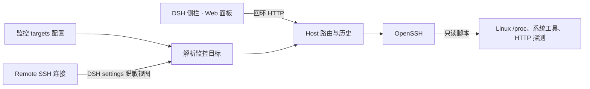

# 项目架构

DSH 根据 bundle patch 挂载 Host 插件并加载 Web 客户端。浏览器请求快照时，Host 为配置的 Linux 目标分别发起只读 SSH，解析采集结果并返回当前样本与短期历史。



## 代码和资源

| 路径 | 职责 |
| --- | --- |
| `package.json`、`cordis.patch.yml` | npm 发布清单、DSH bundle 注册和客户端入口 |
| `index.js` | 注册本机 HTTP 路由，合并同一目标的并发请求并缓存最近 60 次采样 |
| `host/targets.js` | 校验本地配置、通过 DSH settings 解析显式引用的 Remote SSH 连接 |
| `host/ssh.js` | 构建 OpenSSH 参数，检查远程 Linux 环境，报告连接失败原因 |
| `host/collector.js` | 执行 Linux 只读采集脚本，把文本分段解析成面板所需的指标 |
| `client.js` | DSH Web 注册、自动刷新、主机和视图切换、告警与可视化 |
| `locale/`、`docs/` | DSH 插件详情、使用说明和示例截图 |
| `tests/` | 配置与采集逻辑、Remote SSH 连接更新、只读路由和缓存行为的回归测试 |

## 运行方式

- **默认启动**。未配置目标时返回空列表，客户端提示如何添加目标。
- **独立采集**。监控通过 OpenSSH 执行固定脚本。远程服务探测在 Linux 主机上发出，本机浏览器只读回环 API。连接使用严格主机指纹校验。
- **Remote SSH 联动**。仅对显式填了 `remoteSshProfile` 的目标读取 DSH 的脱敏设置，复用连接参数。目标改指向其他主机或 SSH 身份变化后使用新的缓存记录，原来的指标不会附到新目标上。远程终端、文件和工作区由 Remote SSH 自己管理。
- **采样和历史**。CPU、网络与磁盘吞吐使用约 0.6 秒间隔的两次计数器读数。同一目标的并发请求共享当前采样。SSH 失败时保留上次成功数据和时间，新样本在趋势中留下缺口。历史存在 Host 内存。
- **HTTP 契约**。三个路由接受本机 GET。 `/api/server-monitor/snapshot` 返回目标和历史，`/api/server-monitor/connection?target=<id>` 测试已配置目标，`/api/server-monitor/health` 返回插件状态与目标数。

## 构建与验证

Host 和 Web 入口是可直接运行的 JavaScript，打包不需要额外构建器。Node.js 自带测试运行器执行本地回归测试。

```sh
npm run check
npm test
mkdir -p dist
npm pack --pack-destination dist
```

测试包通过 `dsh plugin --profile <试装 profile> add <本地 tgz>` 安装。建议发布前在独立 profile 验证首次打开、直连、引用 Remote SSH、指标可见及卸载。截图可用示例数据。随包发布文件与版本清单以 `npm pack --dry-run` 输出为准。
