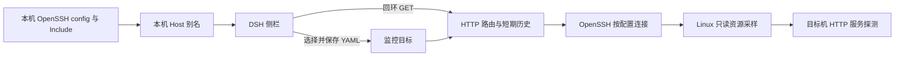

# 项目架构

DSH 挂载 Host 插件并加载 Web 客户端。面板列出本机 SSH 别名，只有保存为监控目标的主机才会启动采集。

| 路径 | 职责 |
| --- | --- |
| `index.js` | 注册回环 HTTP 路由、合并并发请求、缓存采样历史 |
| `host/ssh-config.js` | 枚举 OpenSSH 配置文件声明的具体 Host 别名 |
| `host/targets.js` | 校验监控目标和覆盖的服务地址 |
| `host/ssh.js` | 构造 OpenSSH 命令、严格验证主机指纹、分类连接失败原因 |
| `host/collector.js` | 读取 Linux 资源与进程指标，整理采样快照 |
| `host/services.js` | 在目标机的已知端口探测服务，解析 Grafana、Prometheus 和 Kuma 的读接口 |
| `client.js` | 注册 DSH 面板、SSH 别名选择、指标趋势和监控服务详情 |
| `tests/` | SSH 发现、连接边界、指标解析及服务 HTTP 采集的回归测试 |
| `locale/`、`docs/` | 带入 DSH 插件详情页的文档、截图和配置说明 |

## 采集行为

- **SSH 别名**。枚举工作只读取配置文件中的 Host 模式，跳过通配符与否定规则。OpenSSH 负责实际解析、密钥与 ProxyJump。
- **按需采集**。浏览器打开面板并请求快照后，Host 才连接配置中的目标。Linux 采样脚本以只读命令读取资源与进程。
- **服务数据**。每个服务单独探测，使用固定端点或配置的 URL。Prometheus 抓取摘要、Grafana 数据库状态和 Kuma 公开监控项来自它们自己的读接口。
- **进程内历史**。同一目标的并发请求共享一次采样，最多保留最近 60 次。断连时保留最后一次成功数据并留下趋势缺口。
- **回环 API**。四个路由接受本机 GET。`/api/server-monitor/ssh-hosts` 列出本机别名，`/api/server-monitor/snapshot` 读取快照，`/api/server-monitor/connection?target=<id>` 测试已配置目标，`/api/server-monitor/health` 返回插件状态。

## 打包与发布验证

运行 `npm run check` 和 `npm test`。用 `npm pack --dry-run` 检查文件，再运行 `npm pack --pack-destination dist` 生成不依赖构建器的 DSH 安装包。发布前在独立 DSH profile 安装该包，核对空配置、别名列表、SSH 实采、服务展示和卸载。发布资产附版本号、示例截图与 SHA-256。
