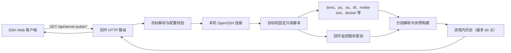

# 项目架构

Server Pulse 由三部分组成：Host 端插件通过本机 OpenSSH 在目标机执行固定的只读脚本；结果经本机回环 HTTP API `/api/server-pulse/*` 暴露；Web 客户端轮询接口并渲染面板。

## 组件与数据流

1. 面板列出本机 `~/.ssh/config`（含 `Include`）中的 `Host` 别名；用户勾选并保存为 `cordis.patch.yml` 中的 `targets` 后才会开始采集。
2. 浏览器打开面板并请求 `/api/server-pulse/snapshot` 时，Host 才连接配置中的目标；同一目标的并发请求共享一次采样。
3. 每条 SSH 连接只发送一段固定的只读脚本，脚本从 `/proc` 等来源取两次读数（间隔约 0.6 秒）以计算速率，并探测 Grafana、Prometheus、Uptime Kuma 与 node_exporter 的官方默认端口。
4. 输出按 `@@KEY` 分段解析为快照；成功采样进入最近 60 点的历史，失败时保留最后一次成功数据并标注时间。
5. 客户端轮询快照，渲染资源趋势、进程/容器明细、服务详情与阈值告警。

## 目录结构

| 路径 | 职责 |
| --- | --- |
| `index.js` | 插件入口：注册回环 HTTP 路由、合并并发请求、缓存采样历史 |
| `client.js` | 注册 DSH 面板、SSH 别名选择、指标趋势、服务详情与告警渲染 |
| `host/ssh-config.js` | 枚举 OpenSSH 配置文件声明的具体 Host 别名 |
| `host/targets.js` | 校验目标 ID、连接参数与服务 URL，明确别名与手填连接互斥 |
| `host/ssh.js` | 构造 OpenSSH 命令、严格校验主机指纹、分类连接失败原因 |
| `host/collector.js` | 读取 Linux 资源与进程指标，构建采样快照 |
| `host/services.js` | 在目标机官方默认端口探测服务，解析 Grafana、Prometheus 与 Kuma 的读接口 |
| `cordis.patch.yml` | Bundle patch：把插件行插入 profile 插件清单 |
| `locale/` | 中英文插件详情与面板文案 |
| `docs/` | 用户文档（安装、架构）与截图资源；`docs/assets/` 存放示例图片 |
| `tests/` | SSH 发现、连接边界、指标解析及服务 HTTP 采集的回归测试 |
| `package.json` | 包元数据、导出与 DSH bundle/client 配置 |
| `icon.svg` | 插件图标 |

## HTTP API

四个路由均为本机回环 GET，路径统一以 `server-pulse` 为命名空间：

| 路由 | 用途 |
| --- | --- |
| `/api/server-pulse/snapshot` | 读取所有目标的快照与最近历史 |
| `/api/server-pulse/connection?target=<id>` | 测试指定目标的 SSH 连通性 |
| `/api/server-pulse/ssh-hosts` | 列出本机 SSH 别名及已监控的别名 |
| `/api/server-pulse/health` | 返回插件状态、目标数量与采样间隔 |

非回环来源、非 GET 方法、带代理转发头或跨域的请求会被拒绝（403 / 405）。

## 安全边界

- **只读**：远程脚本只读取 `/proc`、`/sys`、`df`、`ps`、`ss`、`systemctl --failed`、`nvidia-smi`、`docker stats`，以及经 `curl` 访问目标机回环上的监控服务读接口；不写文件、不改配置、不执行装机操作。
- **非交互连接**：`BatchMode=yes` 禁止口令交互，`RequestTTY=no` 不分配终端，服务地址等外部输入逐项加引号，避免命令注入。
- **指纹校验**：`StrictHostKeyChecking=yes` 严格校验主机密钥，指纹不匹配的主机不会连接。
- **无密钥落盘**：插件不复制或写出私钥。别名模式复用本机 OpenSSH 配置与 ssh-agent；手填模式仅以 `keyPath` 引用用户已有密钥，并配合 `IdentitiesOnly=yes`、`ForwardAgent=no`、`ClearAllForwardings=yes` 与 `ControlPath=none`。
- **本机 API**：HTTP 服务仅监听回环，校验 `Host` / `Origin` / `Sec-Fetch-Site`，拒绝非本机与跨站请求；响应设置 `cache-control: no-store`。
- **内存历史**：采样历史只保存在 Host 进程内存中，最多 60 点，不落盘、不上传。

## 打包与发布验证

运行 `npm run check` 与 `npm test`。用 `npm pack --dry-run` 检查文件清单，再执行 `npm pack --pack-destination dist` 生成不依赖构建器的 DSH 安装包。发布前在独立 DSH profile 安装该包，核对空配置、别名列表、SSH 实采、服务展示与卸载流程；发布资产附版本号、示例截图与 SHA-256。
